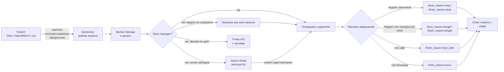
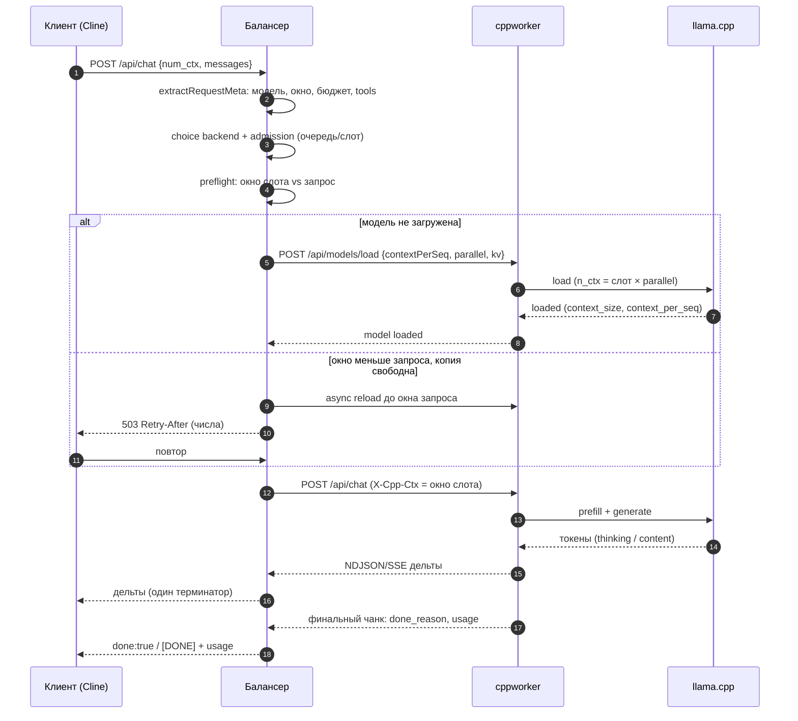
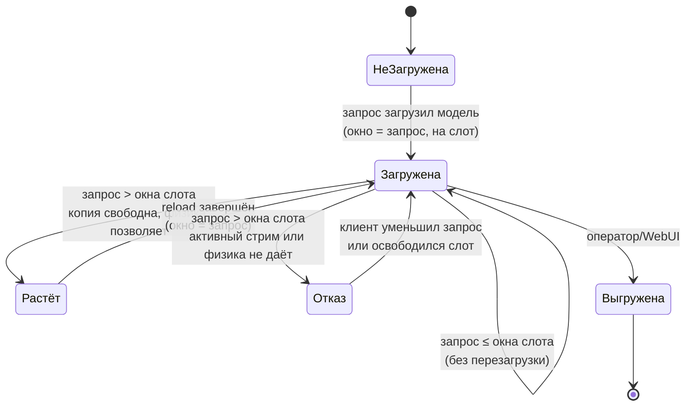
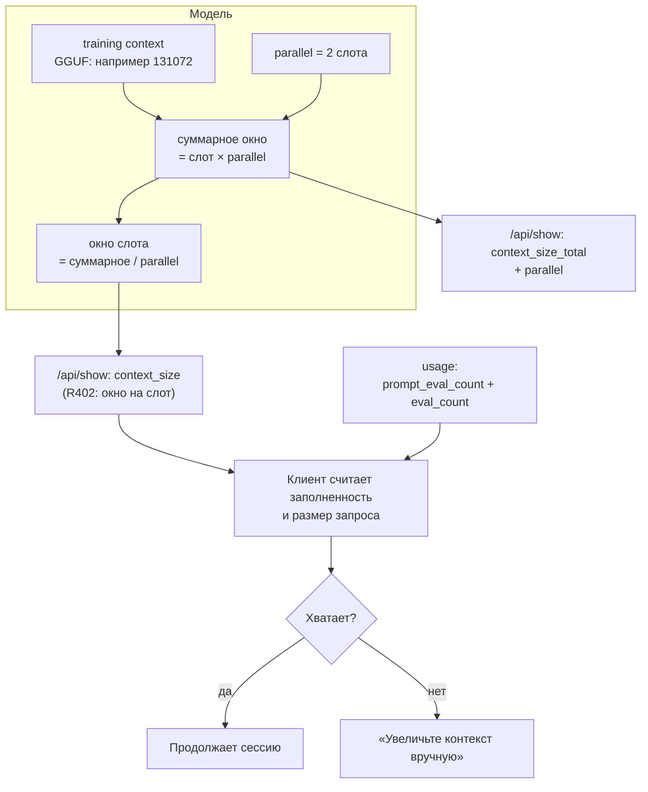
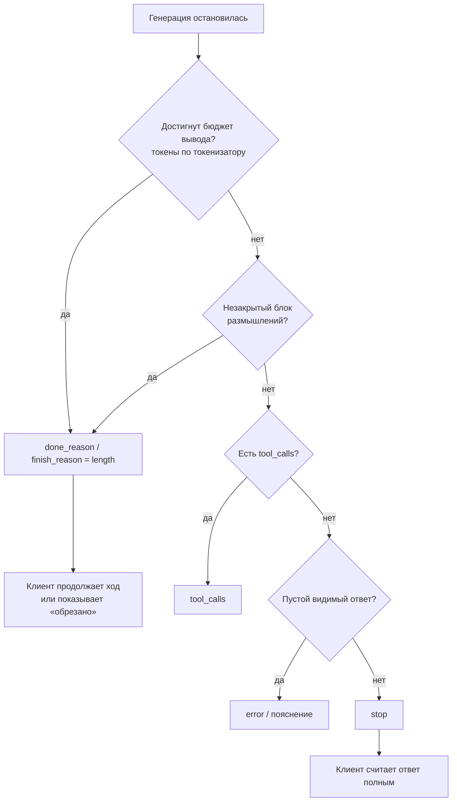
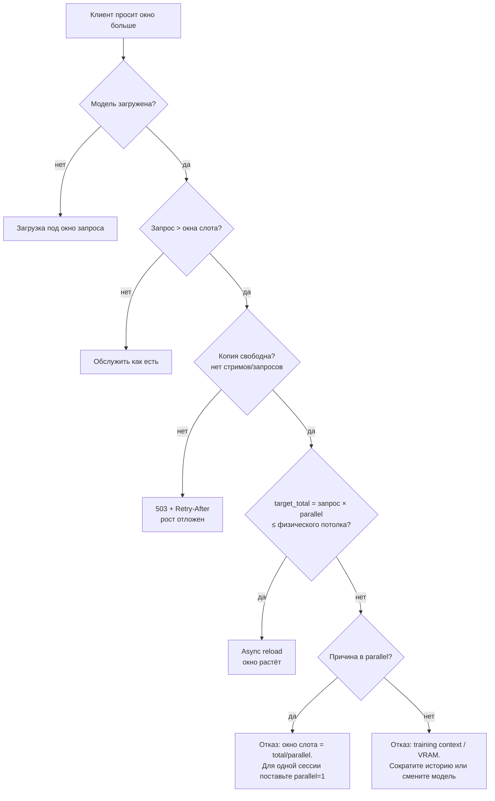

# Как проходит запрос и почему клиент видит именно такой ответ (R417)

Это человекочитаемая схема. Точные формулы, коды ошибок и ссылки на функции — в
техническом документе [`request-lifecycle.md`](request-lifecycle.md).
Интерактивная версия с навигацией по шагам: **WebUI → Настройки → Справка →
«Схема работы»** (или `/scheme.html`).

Главная мысль: у нас **два разных «окна контекста»** — окно на одного клиента
(слот) и суммарное окно модели. Почти все жалобы «клиент видит не то значение»,
«ответ обрезан, но завершён», «не даёт поднять окно» — это путаница между ними
и между «модель закончила» и «мы её оборвали».

---

## 1. Общий конвейер

---

## 2. Холодный запрос: кто что делает по шагам

---

## 3. Состояния окна контекста

Правило: **вниз окно не растёт**. Запрос с меньшим окном обслуживается текущим
окном слота, без перезагрузки.

---

## 4. Почему клиент видит «не тот объём контекста»

Если отдавать клиенту суммарное окно как его собственное (было до R402), клиент
считает, что у него в два раза больше места, чем есть на слот: заполняет историю
до мнимого предела, получает реальное переполнение и просит увеличить контекст.
Если при этом `eval_count` не включает размышления, ошибка усиливается: клиент
не видит, что бюджет уже израсходован.

---

## 5. Почему ответ «завершён», хотя он обрезан

До R402 на OpenAI-стриме бюджет считался по числу callback'ов, а не токенов:
callback'ов меньше, чем токенов, поэтому обрезанный ответ уходил с
`finish_reason=stop` — Cline закрывал ход. Теперь бюджет считается токенизатором
по сырому выводу (включая размышления), как в native-пути с R394.

**R404: размышления на tools-пути отдаются дельтами.** Если клиент присылает
`tools[]` (Cline почти всегда), ответ шёл через `writeChatStreamResponseWithTools`,
и старт блока размышлений включал удержание всего вывода до закрытия блока. При
исчерпании бюджета внутри размышлений блок не закрывался: клиент минутами не
получал ни байта (только keepalive), затем — пустой финальный чанк и ещё один
повтор на те же минуты. Теперь `thinking` уходит кадрами `message.thinking` сразу,
а повтор генерации не запускается, если клиенту уже ушёл хотя бы один кадр.

**R411: бюджет вывода одинаков на /api/chat и /v1.** Раньше native-путь оставлял
`n_predict=4096` даже для reasoning-моделей, а OpenAI-путь давал 8192. Gemma-4
обрывалась на 4096-м токене посреди ответа, Cline видел `done_reason=length` и
запускал overflow-recovery при `inputTokens≈1700` — то есть компактил почти
пустую историю и терял часть переписки. Теперь политика одна: явный
`num_predict`/`max_tokens` клиента → 8192 для reasoning-моделей
(`CPPWORKER_DEFAULT_N_PREDICT_REASONING`) → 4096; объявленная клиентом верхняя
граница (`max_output_tokens`) может только уменьшить значение.

**R414: служебные маркеры не попадают в текст ответа.** На tools-пути поток
режется как сырой буфер, поэтому закрывающий маркер канала gemma-4 (`<channel|>`)
уходил клиенту как обычный текст: в живой сессии Cline ответ заканчивался на
`…run the check command.<channel|>`. Теперь недособранный маркер в хвосте
удерживается, а полный — пропускается.

**R413: клиент, отменённый в очереди за слотом, не «съедает» слот.** Слот
воркера один (`parallel=1`); если клиент закрывал соединение ровно в момент,
когда освобождался слот, слот мог остаться зарезервированным за отменённым
ожидающим — и воркер заклинивало навсегда: `active_queries=1`, GPU простаивает,
новые запросы висят в очереди. Теперь такой слот возвращается в оборот. Побочный
эффект: если вы видите «все слоты заняты» дольше нескольких минут при
простаивающей GPU на старой сборке — перезапустите cppworker; на R413+ этого
состояния быть не должно.

---

## 6. Почему не даёт поднять окно (дерево решений)

Ключевая арифметика: при training context 131072 и `parallel=2` окно слота —
65536. Один клиент (Cline — это одна сессия) не получит 131072, пока модель
загружена с двумя слотами.

---

## 7. Где смотреть причину в логах

| Что хотите понять | Строка в логе балансера | Файл |
|---|---|---|
| почему отказали в окне | `requested_window_above_physical_ceiling` / `auto_reload_ceiling_reason` | `preflight_nctx.go` |
| почему не выросло | `growth_blockers`, `active_streams`, `reload_pending` | `growth_guard_r299.go` |
| какое окно уйдёт в загрузку | `declared n_ctx window resolved`, `context_per_seq` | `nctx_declared_r255.go` |
| почему завершилось | `done_reason`, `finish_reason`, `budget_exhausted`, `generated_tokens` | `handlers_*.go` |
| что видит клиент про окно | `context_size`, `context_size_total`, `parallel` | `handlers_model.go` |
| ждёт ли запрос слот воркера | `inference: all slots busy, request will wait` → `inference: slot acquired after waiting` | `internal/cppbackend/backend.go` |
| почему AutoTune reload не применился | `autotune reload failed … unload failed: cppworker error (HTTP 401)` | `internal/balancer/autotune.go` |
| откуда в ответе `<channel\|>` | сырой хвост дельты; на tools-пути — `toolsStreamMarkerScanR414` | `cmd/cppworker/tools_stream_markers_r414.go` |

---

## 8. Что решено и что осталось

Решено (R403):

1. **`parallel` по умолчанию = 1.** Слоты делят окно, поэтому одиночная сессия
   (Cline) получает всё окно. Больше оператор ставит сам в профиле модели или в
   `CPPWORKER_N_PARALLEL`.
2. **Отдельная очередь ожидания свободного бэкенда** (`LB_BACKEND_WAIT_SEC`,
   default 120 c): когда ни одного подходящего бэкенда нет (offline/disabled/
   донор), запрос ждёт его появления FIFO по модели, а не получает 503 сразу.
   Это не очередь слота: слот ждут уже на выбранном бэкенде. В смешанном режиме
   (standard) то же ожидание выполняет единая admission-очередь («любой бэкенд +
   слот»); отдельная очередь R403 работает на llama.cpp-router пути. Тумблер
   «не использовать бэкенд» теперь действует на обоих путях (R403.1/R403.2).
3. **`/api/show.parameters` = `num_ctx <окно>`**, как у настоящего Ollama;
   размер модели остался в `details.parameter_size`.

Решено (R412–R414):

4. **AutoTune reload не падает с 401.** Unload в плане reload передавал имя
   модели вместо ID бэкенда, поэтому заголовок токена не ставился и воркер
   отвечал `401 invalid or missing API token`. Теперь unload несёт токен своего
   бэкенда, а «занято» (409) по-прежнему откладывается с backoff, а не считается
   поломкой.
5. **Слот/бюджет/маркеры** — см. блок «Почему ответ завершён, хотя он обрезан»
   выше: R411 (бюджет), R413 (слот воркера), R414 (маркеры в тексте).

Решено (R415–R417):

6. **Qwen3.8 — reasoning-модель.** `qwen3.8` добавлен в `ReasoningArchPrefixes`:
   без этого 9B/27B Qwen3.8 на `/api/chat` получали `n_predict=4096` и
   обрывались посреди ответа (та же беда, что R411 закрыл для gemma-4).
7. **AutoTune не перезагружает модель после каждого ответа.** Причина —
   обратная связь «оптимальный KV по свободной VRAM»: q8_0 → q4_0 → q8_0, плюс
   `layers=-1` при уже полном offload, плюс неизвестный/сохранённый `n_ctx`.
   Четыре гарда (R416/R416b/R416c/R416d) останавливают петлю; явный
   `kvCacheType` профиля AutoTune не оспаривает.
8. **Вызов инструмента — это ответ хода.** При распознанных `tool_calls` в
   `content` больше не подставляется пояснение «модель сгенерировала только
   размышления» (R417): клиент сохранял его как сообщение ассистента рядом с
   валидным вызовом.

Решено (R423):

9. **Карта профилей моделей — под замком.** Профили писал хендлер админки
   (`PUT/DELETE /api/v1/cppworker/model-profiles`, AutoTune per-model, импорт
   `config.json`), а читали горячие пути запроса — резолв окна, preflight
   `n_ctx`, выбор модели для загрузки, AutoTune, таймауты. Это разные горутины,
   и обычная map в Go такое не переживает: CI ловил `DATA RACE`, а в бою это
   могло закончиться фатальным `concurrent map read and map write` (падение
   всего балансера). Теперь у прокси есть `profilesMu`, читатели берут СНИМОК
   карты и работают с ним без замка (никакой логики под замком — дедлок
   невозможен), записи идут через `SetModelProfile`/`DeleteModelProfile`/
   `UpdateModelProfile`/`ReplaceModelProfiles`. Импорт конфига подменяет
   `config` целиком под тем же замком (`SwapConfigContentR423`).

Решено (R425):

10. **AutoTune не опускает окно ниже профиля модели.** Профиль (`contextLength`) —
    политика оператора, а не повод для «over-allocation fix». Живой случай на стенде
    (балансер r261103-2245): сразу после первого запроса без `num_ctx` AutoTune
    выгрузил модель, чтобы поставить окно 32768 → 20654, хотя в профиле заявлено
    32768 (потолок 65536). Клиент с окном 32768 получил бы 20654 и оборвался бы по
    контексту. Нижняя граница плана = max(запрос клиента R69, `contextLength` профиля).
11. **Советы монитора учитывают ТИП бэкенда.** В очереди стоял запрос к llama.cpp, а
    баннер называл свободным imageworker (image.cpp) и предлагал «перераспределить»
    нагрузку: перекладка текстовой модели на image-бэкенд заведомо даёт ошибку
    (backend type isolation). Свободные/альтернативные бэкенды теперь фильтруются по
    типу, длинное имя модели и User-Agent обрезаются по ширине карточки, а подсказка
    переносится по словам.

Решено (R426–R433) — почему Cline «не мог работать с балансером»:

12. **Преамбула инструментов больше не двусмысленна** (R426). Список инструментов
    уходил в системную преамбулу с формулировками, которые читались как «можно
    ответить текстом»: модель (особенно маленькая) писала содержимое файла в
    ответ прозой, а `editor` не вызывала. Теперь формат вызова один и явный.
13. **Сырой вывод нераспознанного вызова сохраняется** (R427). Раньше причина
    «почему инструмент не вызван» была невидима: в логе только `tool_calls=0`, а
    сам вывод модели выбрасывался. Теперь он лежит в файле
    (`CPPWORKER_UNPARSED_CAPTURE_FILE`, по умолчанию `/app/diag/…`) и доступен
    через `GET /api/v1/cppworker/debug/unparsed` вместе с именами инструментов и
    бюджетом ответа.
14. **Форма вызова gemma `call:NAME(…)` распознаётся** (R428). На большом
    содержимом gemma-4 выдаёт питоновскую запись вызова: круглые скобки, пары
    `ключ: значение`, без закрывающего тега и с мусором `"}]` в конце. Прежние
    стратегии её не видели → `tool_calls=0`. Плюс два правила: вызов
    НЕобъявленного инструмента (`write_file`) переводится на объявленный
    (`editor`) или отбрасывается, а нераспознанная разметка больше не убивает ход
    (`done_reason:error` заменён обычным ответом с пояснением).
15. **Тело вызова не попадает в content** (R429). После распознанного вызова
    cppworker «добирал» хвост как прозу — и клиент получал в ответ всё тело
    вызова: живой прогон Cline принял 3441 байт из 3442, то есть HTML файла
    целиком (он осел в истории Cline и портил следующие ходы). Теперь хвост
    режется по НАЧАЛУ разметки вызова (теги, JSON-формы, `call:NAME(`), скобка с
    переводом строки после неё тоже считается началом вызова, а одиночные
    маркеры размышлений (`<channel|>`) вычищаются из дельт. Заодно исправлена
    сводка: `streamed_content_bytes` теперь считает реально отданные клиенту
    байты (раньше печаталась позиция в буфере и занижала поток: 3714 против
    принятых клиентом 14133), рядом появилось поле `emitted_len`.
16. **Переэкранированная разметка опознаётся** (R430). Тот же класс, другая форма:
    gemma выдаёт `\"function\":{\"name\":\"editor\"…` — кавычки ключей
    переэкранированы, скобки не сбалансированы. Ни один разбор её не видел, и
    проверка «это разметка вызова?» отвечала «нет», поэтому не срабатывали ни
    пояснение, ни сохранение сырого вывода: 3441 байт из 3442 уехали клиенту.
    Теперь форма опознаётся и уходит в диагностику, в content её нет, клиент
    получает прозу + пояснение «вызов не выполнен, повторите» — и на потоковых,
    и на НЕпотоковых поверхностях (`/api/chat`, OpenAI). Парсить её намеренно НЕ
    пытаемся: починить = угадать, что модель имела в виду, а цена ошибки — запись
    файла чужим текстом.
17. **Вызов без поля `name` восстанавливается по `id`** (R431). Живой скриншот
    оператора (Cline в VS Code): модель перечислила план прозой, затем выдала
    `[TOOL_CALLS][{"id":"call_read_files","type":"function","function":{"files":["TASK.md"]}}]`
    — имени нет, аргументы вложены прямо в `function`. Все разборы требуют `name`
    → `tool_calls` пуст → ход закрылся `done_reason=stop`, и Cline показал
    «COMPLETED» с пояснением в теле ответа: файл не создан, цикл встал. Теперь имя
    берётся из `id` по соглашению `call_<имя>` и принимается ТОЛЬКО если такой
    инструмент объявлен в самом запросе; аргументы — `arguments` либо остальные
    ключи `function`. Дальше работают приведение по схеме и фильтр R428, поэтому
    чужой инструмент по-прежнему не выполнится.
18. **Преамбула инструментов больше НЕ НАВЯЗЫВАЕТ придуманный формат** (R432).
    Главная причина «gemma-4 перестала быть агентской»: R426 требовал «ровно одну
    строку»
    `[TOOL_CALLS][{"id":"call_<tool>","type":"function","function":{"name":…,"arguments":…}}]`
    — гибрид маркера Mistral и OpenAI-объекта, которого нет ни в одном формате, на
    котором модели обучены. Модель копировала скелет и теряла поля: снятый живьём
    вывод — `[TOOL_CALLS][{"id":"call_read_files","type":"function","function":{"files":["TASK.md"]}}]`
    (нет `name`, нет `arguments`, аргументы вложены в `function`). Теперь в
    преамбуле перечислены РЕАЛЬНЫЕ формы (`<tool_call>{"name":…,"arguments":…}`,
    `[TOOL_CALLS][{"name":…}]`, `call:<tool>(<arg>: <value>, …)`), и модель вправе
    использовать ту, что задаёт её шаблон. Поведенческие правила R426 («зови
    инструмент, а не вставляй артефакт в ответ») сохранены.
19. **Две нативные формы перестали теряться** (R432): строки в спец-токенах gemma
    (`call:read_files(files:[<|"|>TASK.md<|"|>])`) и в питоновских одинарных
    кавычках (`read_files(files: ['C:\\…\\TASK.md'])`). Плюс исправлен trim
    аргументов: хвостовой `]` значения-МАССИВА больше не снимается как «мусор»
    (из-за этого терялись вызовы с массивами, например `run_commands`).
20. **JSON-обёртка с `tool_calls` — это вызов** (R433). Модель ответила целым
    документом `{"tool_calls":[{"name":"read_files","arguments":{…}}],"output":""}`
    — верхнеуровневых `name`/`arguments` там нет, вызов считался текстом и уезжал
    клиенту как ответ. Теперь обёртка разбирается (и считается разметкой вызова,
    чтобы не попадать в `content`).

Осталось (архитектурное, следующий шаг):

- **Инструменты не передаются в chat template.** В `c/bridge/csrc/chat_thinking.cpp`
  вызов `common_chat_templates_apply` идёт с `tools=empty`: модель НЕ видит
  нативную секцию инструментов своего шаблона, и формат задаётся нашей текстовой
  преамбулой. Правильный путь (как в llama-server/ollama) — передавать `tools[]` в
  шаблон и не добавлять преамбулу, когда шаблон отрисовал инструменты сам;
  преамбула остаётся только fallback'ом. Это убирает саму возможность конфликта
  форматов, а не лечит его последствия.

Осталось (нужно решение/следующий шаг):

1. **Семантика окна по протоколам.** Переключение семантики (per-seq как в
   Ollama vs total как сейчас) не должно быть глобальным: оно изолируется по
   протоколу (ollama / openai и будущие маршруты). Механизм — резолвер семантики
   по `request path`; до его включения оба пути работают на текущей семантике.
2. Авто-снижение `parallel` под запрос одного клиента (если других сессий нет) —
   не реализовано; обсуждается.
3. **Потолок `n_predict` для reasoning-моделей** (R411: 8192 по умолчанию). На
   слабой карте это десятки минут на один ход; оператор может снизить значение
   через `CPPWORKER_DEFAULT_N_PREDICT_REASONING`, но тогда вернутся обрывы
   `done_reason=length` и overflow-recovery у Cline. Явного выбора пока нет —
   значение 8192 выбрано как компромисс.

