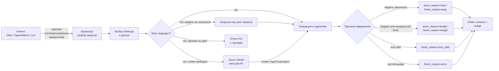
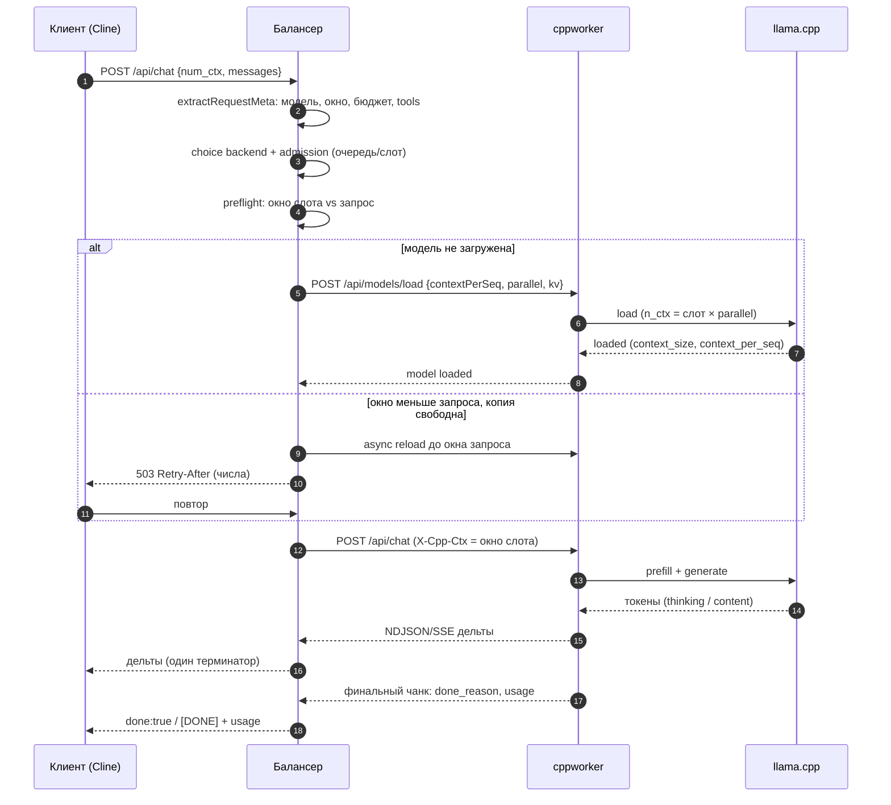
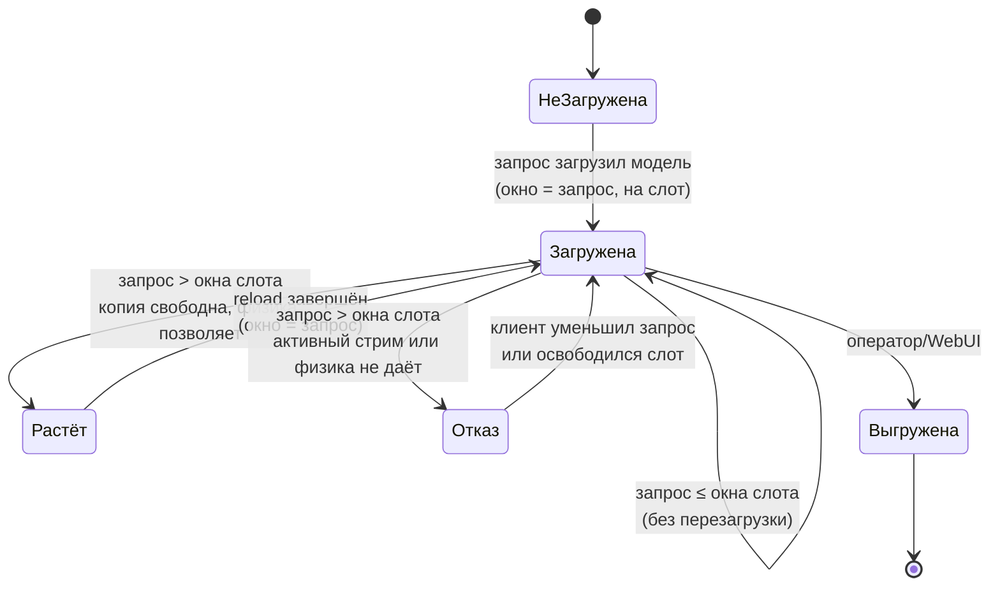
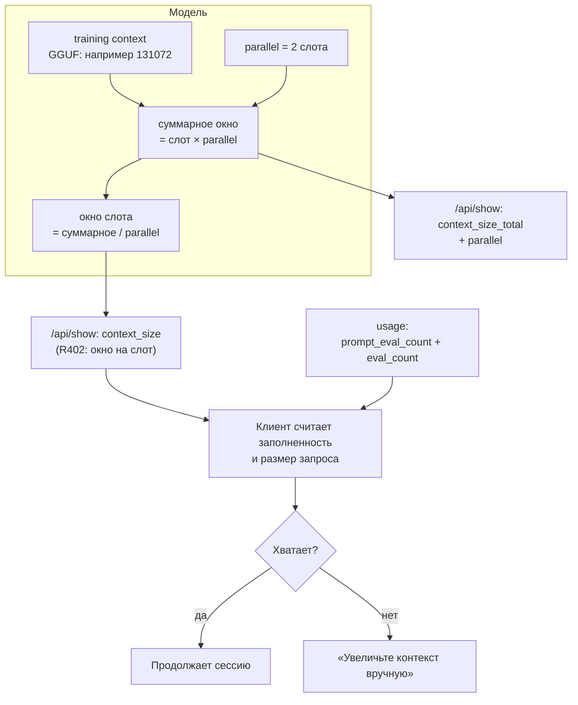
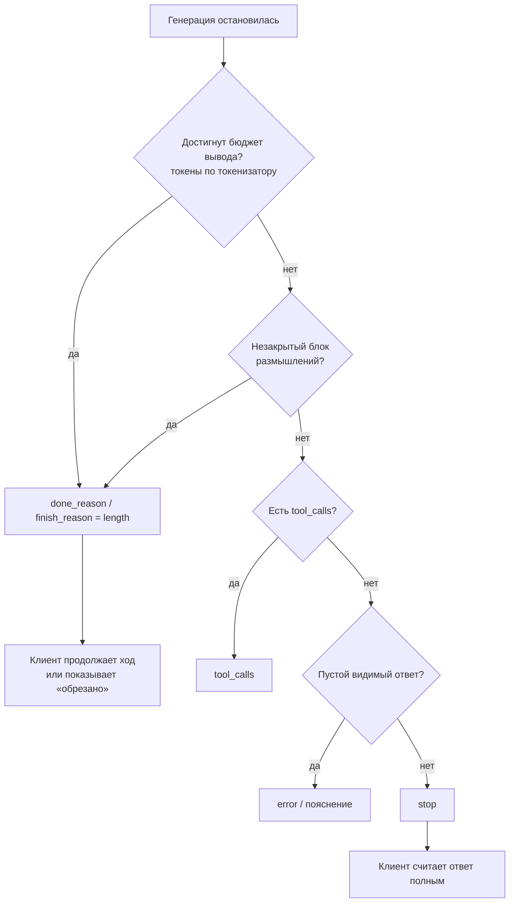
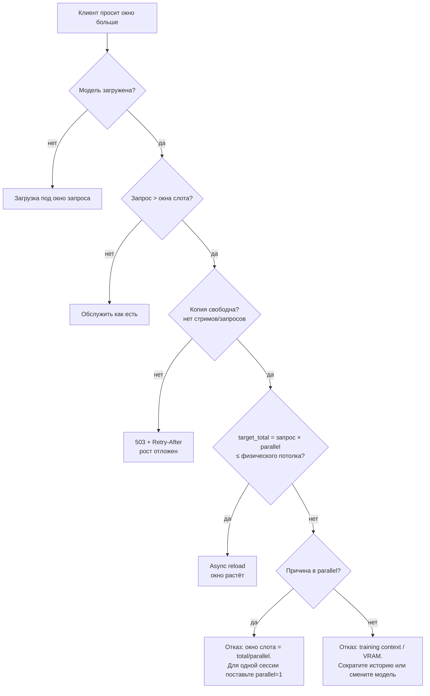

# Как проходит запрос и почему клиент видит именно такой ответ (R402)

Это человекочитаемая схема. Точные формулы, коды ошибок и ссылки на функции — в
техническом документе [`request-lifecycle.md`](request-lifecycle.md).
Интерактивная версия с навигацией по шагам: **WebUI → Настройки → Справка →
«Схема работы»** (или `/scheme.html`).

Главная мысль: у нас **два разных «окна контекста»** — окно на одного клиента
(слот) и суммарное окно модели. Почти все жалобы «клиент видит не то значение»,
«ответ обрезан, но завершён», «не даёт поднять окно» — это путаница между ними
и между «модель закончила» и «мы её оборвали».

---

## 1. Общий конвейер

---

## 2. Холодный запрос: кто что делает по шагам

---

## 3. Состояния окна контекста

Правило: **вниз окно не растёт**. Запрос с меньшим окном обслуживается текущим
окном слота, без перезагрузки.

---

## 4. Почему клиент видит «не тот объём контекста»

Если отдавать клиенту суммарное окно как его собственное (было до R402), клиент
считает, что у него в два раза больше места, чем есть на слот: заполняет историю
до мнимого предела, получает реальное переполнение и просит увеличить контекст.
Если при этом `eval_count` не включает размышления, ошибка усиливается: клиент
не видит, что бюджет уже израсходован.

---

## 5. Почему ответ «завершён», хотя он обрезан

До R402 на OpenAI-стриме бюджет считался по числу callback'ов, а не токенов:
callback'ов меньше, чем токенов, поэтому обрезанный ответ уходил с
`finish_reason=stop` — Cline закрывал ход. Теперь бюджет считается токенизатором
по сырому выводу (включая размышления), как в native-пути с R394.

---

## 6. Почему не даёт поднять окно (дерево решений)

Ключевая арифметика: при training context 131072 и `parallel=2` окно слота —
65536. Один клиент (Cline — это одна сессия) не получит 131072, пока модель
загружена с двумя слотами.

---

## 7. Где смотреть причину в логах

| Что хотите понять | Строка в логе балансера | Файл |
|---|---|---|
| почему отказали в окне | `requested_window_above_physical_ceiling` / `auto_reload_ceiling_reason` | `preflight_nctx.go` |
| почему не выросло | `growth_blockers`, `active_streams`, `reload_pending` | `growth_guard_r299.go` |
| какое окно уйдёт в загрузку | `declared n_ctx window resolved`, `context_per_seq` | `nctx_declared_r255.go` |
| почему завершилось | `done_reason`, `finish_reason`, `budget_exhausted`, `generated_tokens` | `handlers_*.go` |
| что видит клиент про окно | `context_size`, `context_size_total`, `parallel` | `handlers_model.go` |

---

## 8. Открытые вопросы (нужно решение оператора)

1. `parallel=2` на стенде делит окно между слотами. Для одиночных агентских
   сессий (Cline) имеет смысл `parallel=1` в профиле модели.
2. Переходить ли на «ollama-семантику» суммарного окна (клиентское окно × слоты
   без ограничения training context) — влияет на память и потолки.
3. Нужна ли отдельная очередь «нет свободного бэкенда» вместо async reload/503.
